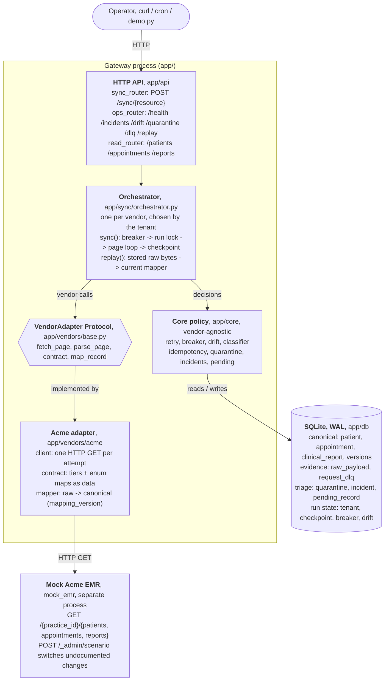
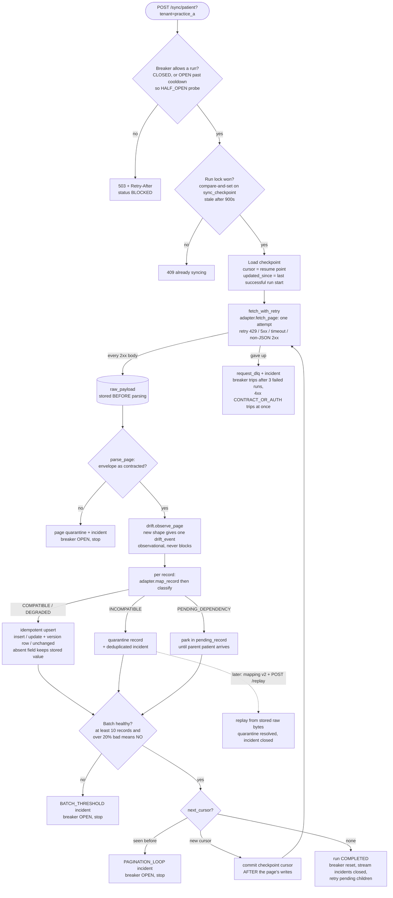
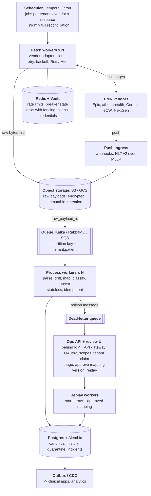

# System design diagrams

Two views of the same design:

1. **[Current system](#1-current-system-what-this-repository-runs)**: what this repository actually runs.
2. **[One sync run](#2-one-sync-run-the-pipeline-inside-the-orchestrator)**: the pipeline inside the orchestrator, with every failure exit.
3. **[Production system](#3-production-system-how-it-scales-out)**: the same pipeline split into services for many vendors and tenants (described, not built).

The full reasoning behind each box is in [ARCHITECTURE.md](ARCHITECTURE.md).

---

## 1. Current system (what this repository runs)

Two processes: the **gateway** and a **mock Acme EMR** that can be switched into undocumented-change scenarios.
Everything to the left of `app/vendors` is vendor-agnostic; only `app/vendors/acme/` knows Acme exists.

**How to read it**

| Box | Responsibility | Never does |
|---|---|---|
| `app/api` | Validate input, map outcomes to HTTP codes (404 unknown tenant, 409 run in progress, 503 + `Retry-After` breaker open) | Business logic |
| `orchestrator` | Runs one sync or replay end to end; owns the transaction and checkpoint boundaries | Know vendor field names |
| `app/core` | Policy: retry, drift, classify, write idempotently, quarantine, open incidents, trip breakers | Import anything from `acme/` |
| `app/vendors/acme` | Facts about Acme: URL shape, envelope, field paths, enum translations | Decide whether a record is written |
| SQLite | Everything durable, including the raw bytes, so replay never needs the vendor | |

---

## 2. One sync run (the pipeline inside the orchestrator)

Every way a run can stop is shown. **Nothing reaches the canonical tables without passing the classifier.**

---

## 3. Production system (how it scales out)

The **same pipeline steps**, split across services connected by a queue. Described in the README
(Q4, Q5) and ARCHITECTURE §10; not built in this repository.

**Cross-cutting, not drawn to keep the diagram readable:** OpenTelemetry traces from fetch to
database; Prometheus metrics (`sync_lag`, `quarantine_depth`, `drift_rate`, `breaker_state`,
`retry_count`) with Alertmanager to PagerDuty; an audit log and PHI-redacted logs; nightly contract
canaries against each vendor's sandbox, so drift is caught before production traffic sees it.

### What each current component becomes

| Current (this repo) | Production | Why it changes |
|---|---|---|
| `POST /sync` called by a person or cron | Scheduler (Temporal or cron) + nightly full reconciliation | Long syncs shouldn't hold an HTTP request; a scheduled full sync catches shape changes that never bump `updated_since` |
| `orchestrator.sync()` in one process | Fetch workers + queue + process workers | Fetching (network-bound) and processing (CPU/DB-bound) scale independently |
| `raw_payload` table (bytes in SQLite) | Object storage, encrypted, with a retention policy | Blobs are cheaper and safer outside the DB; PHI controls |
| Run lock on `sync_checkpoint` | Redis/DB lock **with fencing tokens** | A worker that wakes up after its lock expired must not advance the checkpoint |
| `circuit_state` table | Breaker state + rate-limit buckets in Redis | All workers for one tenant share one budget and one breaker |
| Optimistic lock on concurrent writes | Partition key `tenant:patient` | Prevent the race instead of resolving it: one patient's updates are processed in order |
| SQLite (WAL) | Postgres + Alembic | Concurrent writers, migrations, managed backups |
| `/replay` endpoint | Replay workers triggered from a review UI | Large replays run in the background, with an audit trail of who approved which mapping version |
| structlog JSON + `/health` | OpenTelemetry + Prometheus + Alertmanager | Alerts on quarantine depth, drift rate and sync lag instead of polling |
| No auth | IdP + API gateway: scopes (`sync:run`, `ops:replay`, `phi:read`) and a tenant claim | Least privilege; a caller only sees its own tenants |
| `ADAPTER_FACTORIES = {"acme": ...}` | One adapter package per vendor, plus contract canaries | New vendor = new adapter; the core and pipeline don't change |

**What does not change:** the pipeline order (raw before parse, classify before write, checkpoint after commit), the natural key `(vendor, tenant_id, vendor_id)`, the criticality tiers, and the rule that nothing is guessed. Production adds scale and operations around the same correctness core.
